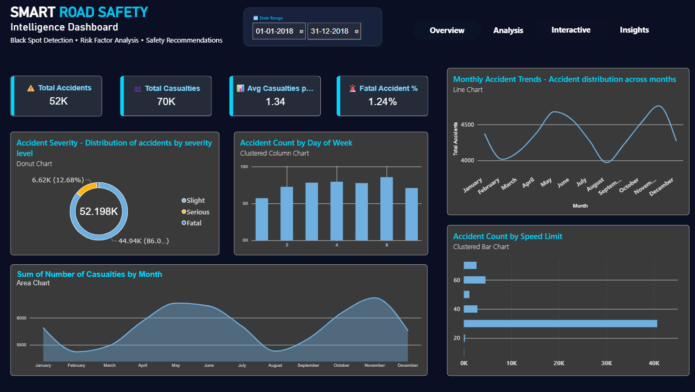
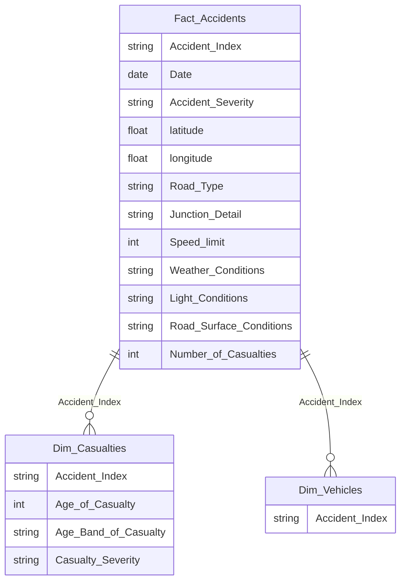
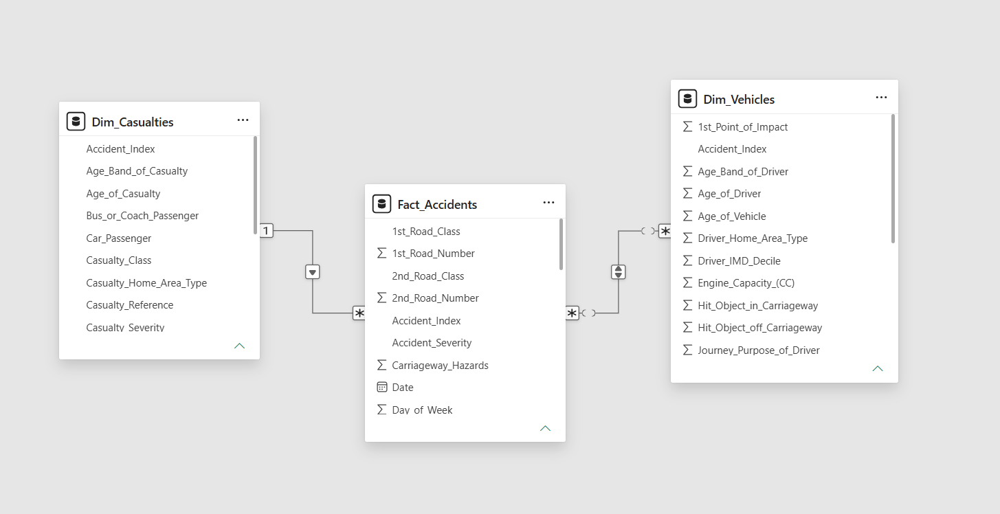
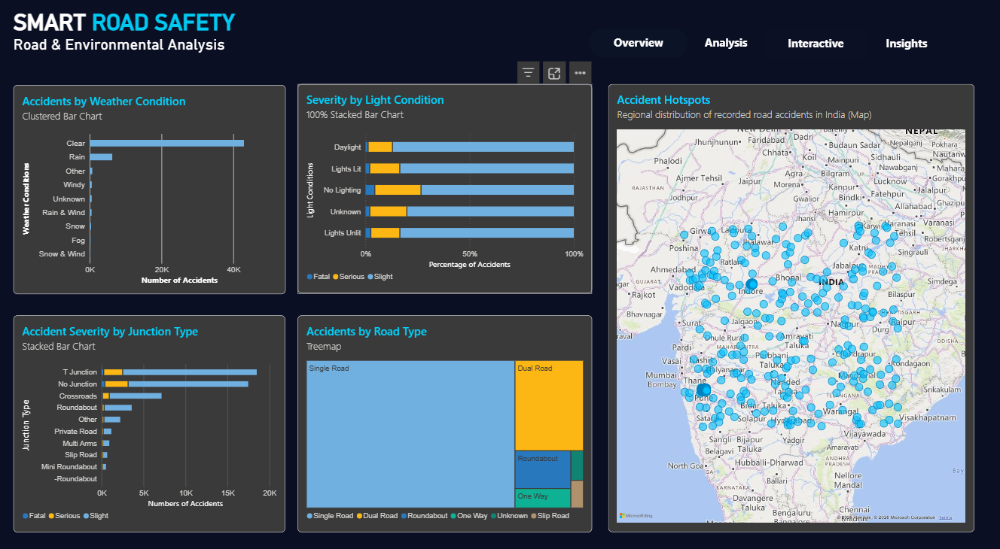
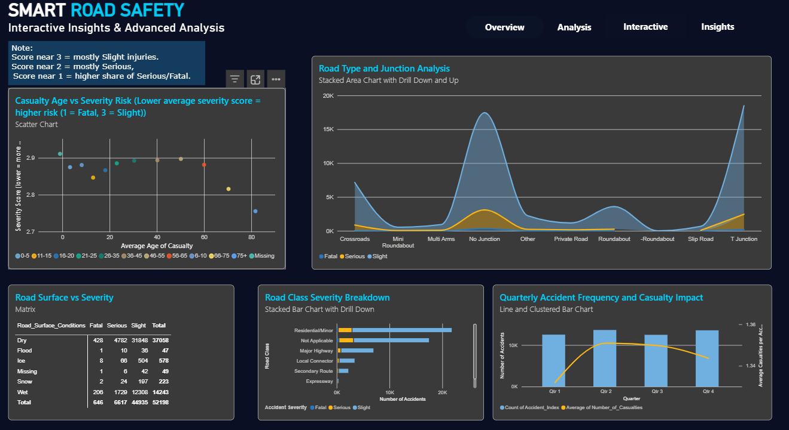
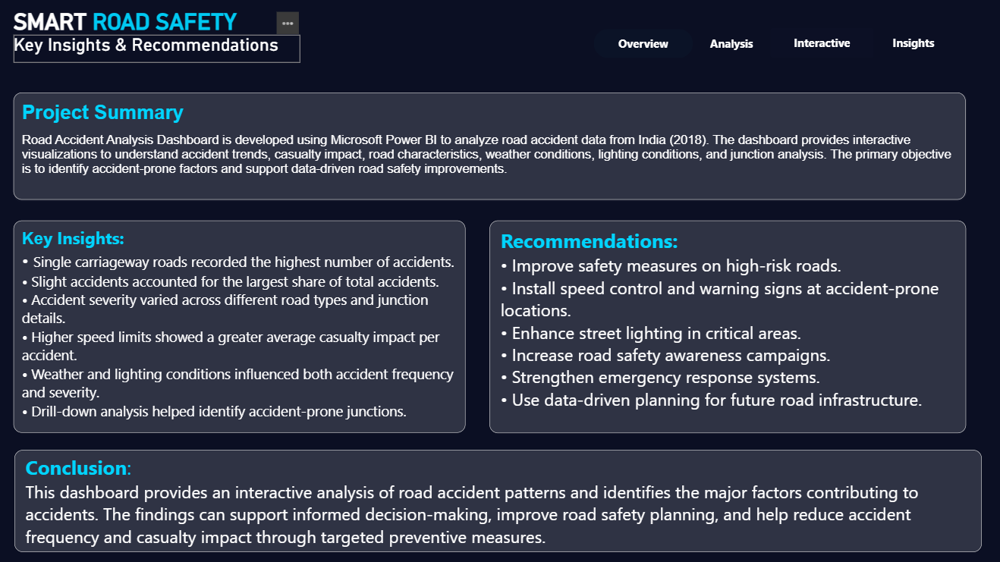

<!-- ===================== HEADER BANNER ===================== -->
<div align="center">


<a href="https://git.io/typing-svg">
  
</a>

<br/>


<br/>



<sub>👆 Overview page of the dashboard</sub>

</div>

---

## 🧭 Quick Navigation

<div align="center">

[📌 Overview](#-project-overview) •
[🎯 Objectives](#-objectives) •
[🧰 Tech Stack](#-tech-stack) •
[🗄️ Data Model](#️-data-model) •
[📊 Dashboard Pages](#-dashboard-pages) •
[🧮 KPIs](#-key-measures) •
[💡 Insights](#-key-insights) •
[✅ Recommendations](#-recommendations) •
[🚀 Run It](#-how-to-use)

</div>

---

## 📌 Project Overview

> **Road accidents are preventable, but only if we know where, when and why they happen.**

This project uses **Microsoft Power BI** to analyze 2018 road accident data. The dashboard turns raw records into interactive visuals showing accident trends, casualty impact, road characteristics, weather and lighting conditions, and junction-level risk, so safety teams can act on evidence.

<div align="center">

| 🚨 Detect | 🔍 Analyze | 🛡️ Recommend |
|:---:|:---:|:---:|
| Find accident hotspots and black spots | Understand risk factors behind severity | Turn findings into safety actions |

</div>

---

## 🎯 Objectives

- ✅ Track accident and casualty volume over time
- ✅ Compare severity (**Slight / Serious / Fatal**) across roads, junctions, weather and light
- ✅ Locate accident hotspots on a map
- ✅ Find which casualty age groups face the highest severity risk
- ✅ Convert findings into practical safety recommendations

---

## 🧰 Tech Stack

<div align="center">

| Tool | Used For |
|:---:|:---|
|  | Report design, interactivity, page navigation |
|  | Data cleaning and transformation |
|  | KPI measures and calculations |
|  | Custom dark layout, 1920×1080 |

</div>

---

## 🗄️ Data Model

The model has **1 fact table** and **2 dimension tables**.



<details>
<summary><b>📸 View model diagram from Power BI</b></summary>
<br/>

</details>

---

## 📊 Dashboard Pages

<div align="center">


<sub>Every page has top-right navigation buttons to jump between pages.</sub>

</div>

<br/>

### 🏠 Page 1: Overview
High-level KPIs and trends with a 📅 **Date Range** slicer.

- 🔢 **KPI cards:** Total Accidents • Total Casualties • Avg Casualties per Accident • Fatal Accident %
- 📈 Monthly accident trends (line chart)
- 🍩 Accident severity distribution (donut)
- 📊 Accidents by day of week (column)
- 🚦 Accidents by speed limit (bar)
- 🌊 Casualties by month (area)

<div align="center"></div>

### 🛣️ Page 2: Road & Environmental Analysis

- 🗺️ **Accident Hotspots** map (latitude / longitude)
- 🌙 Severity by light condition (100% stacked bar)
- 🌧️ Accidents by weather condition (bar)
- 🔀 Severity by junction type (bar)
- 🧱 Accidents by road type (treemap)

<div align="center"></div>

### 🎛️ Page 3: Interactive Insights & Advanced Analysis

- 🏗️ Road type and junction analysis (stacked area, drill-down)
- 🎯 Casualty age vs severity risk (scatter)
- 🧊 Road surface vs severity (matrix)
- 🛤️ Road class severity breakdown (1st and 2nd class)
- 📆 Quarterly accident frequency and casualty impact (combo chart)

> 🧠 **Severity score guide**
> `3` = mostly **Slight** injuries • `2` = mostly **Serious** • `1` = higher share of **Serious / Fatal**.
> **Lower score = higher risk.**

<div align="center"></div>

### 💡 Page 4: Key Insights & Recommendations
Project summary, findings, recommendations and conclusion.
<div align="center"></div>

### 🙏 Page 5: Thank You
Closing page: *"Road Pe Dhyan, Ghar Pe Muskaan!"*

---

## 🧮 Key Measures

<div align="center">

| | Measure | What it tells you |
|:---:|:---|:---|
| ⚠️ | `Total Accidents DAX` | How many accidents happened |
| 👥 | `Total Casualties DAX` | How many people were affected |
| 📊 | `Avg Casualties per Accident` | How severe an average accident is |
| 🚨 | `Fatal Accident %` | Share of accidents that were fatal |

</div>

---

## 💡 Key Insights

<table>
<tr>
<td width="50%">

🛣️ **Single carriageway roads** recorded the highest number of accidents.

🟢 **Slight accidents** made up the largest share of all accidents.

🔀 **Severity varied** across road types and junction details.

</td>
<td width="50%">

🚦 **Higher speed limits** showed greater average casualty impact per accident.

🌦️ **Weather and lighting** influenced both frequency and severity.

🎯 **Drill-down analysis** helped identify accident-prone junctions.

</td>
</tr>
</table>

---

## ✅ Recommendations

| # | Action | Focus |
|:-:|:---|:---:|
| 1 | Improve safety measures on high-risk roads | 🛣️ Roads |
| 2 | Install speed control and warning signs at accident-prone locations | 🚦 Speed |
| 3 | Enhance street lighting in critical areas | 💡 Lighting |
| 4 | Increase road safety awareness campaigns | 📢 Awareness |
| 5 | Strengthen emergency response systems | 🚑 Response |
| 6 | Use data-driven planning for future road infrastructure | 📊 Planning |

---

## 🚀 How to Use

```bash
# 1. Clone the repository
git clone https://github.com/your-username/smart-road-safety-dashboard.git
```

1. 📂 Open `Smart_Road_Safety_Intelligence_Dashboard_Final_Project.pbix` in **Power BI Desktop**
2. 🔗 If prompted, update the data source path: *Transform Data → Data source settings*
3. 📅 Use the **Date Range** slicer and click visuals to cross-filter
4. 🧭 Use the top-right buttons to move between pages

<details>
<summary><b>📁 Project structure</b></summary>

```
📦 smart-road-safety-dashboard
 ┣ 📜 Smart_Road_Safety_Intelligence_Dashboard_Final_Project.pbix
 ┣ 📂 data/        → source dataset(s)
 ┣ 📂 images/      → dashboard screenshots
 ┗ 📜 README.md
```
</details>

---

## 👤 Author

<div align="center">

**[Your Name]**

[](https://linkedin.com/in/your-profile)
[](https://github.com/your-username)
[](mailto:you@example.com)

⭐ *If you found this project useful, give it a star!* ⭐

### 🚗 Road Pe Dhyan, Ghar Pe Muskaan! 😊


</div>
